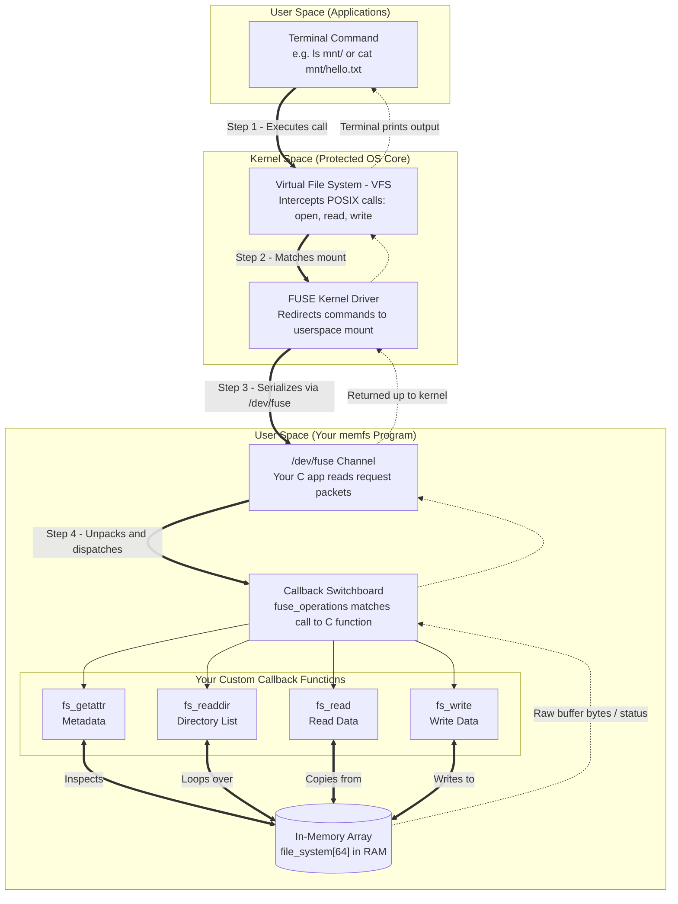

# memfs: An In-Memory FUSE Filesystem in C

`memfs` is a custom, single-threaded Unix filesystem implemented in userspace using the **FUSE 3 (Filesystem in Userspace)** framework and the C programming language. Rather than reading and writing raw blocks to a physical disk or SSD, `memfs` translates POSIX filesystem operations directly into in-memory data structures residing in RAM.

---


### 1. Project Description
Standard modern operating system kernels manage physical storage via native filesystem drivers (e.g., ext4, Btrfs, XFS) operating in protected kernel space. While highly performant, kernel-level filesystem development carries significant risk: minor bugs or pointer miscalculations can trigger kernel panics.

`memfs` addresses this challenge by implementing an educational, functional filesystem in userspace using the Linux FUSE API. The filesystem acts as a virtual storage target mounted at an arbitrary directory (e.g., `mnt/`). When standard Linux utilities (`ls`, `cat`, `echo`, `mkdir`, `touch`) interact with the mount point, the Linux Virtual File System (VFS) routes requests through `/dev/fuse` to the `memfs` userspace process. The program executes the corresponding callbacks in memory and returns standard POSIX status codes back to the OS.

### 2. Goals & Learning Objectives
* **POSIX & VFS Interface:** Master how the Linux Virtual File System maps human-readable terminal commands to POSIX file system hooks (`getattr`, `readdir`, `read`, `write`, `create`, `mkdir`).
* **Systems Programming in C:** Gain practical experience with low-level memory layout, pointer mechanics, fixed-size buffering, and error propagation (`errno`).
* **Userspace Filesystem Architecture:** Understand the interaction between the kernel-space FUSE driver and userspace callback loops.


### 3. System Specifications

#### Architectural Limits
To ensure memory safety and minimize fragmentation during initial phases, `memfs` enforces fixed-size parameters:

| Parameter | Specification | Notes |
|---|---|---|
| **Max Tracked Nodes** | 64 entries | Total capacity for regular files and directories. |
| **Max Path Length** | 256 bytes | Maximum absolute path length (e.g., `/docs/notes.txt`). |
| **Max File Capacity** | 64 Kilobytes (65,536 bytes) | Fixed byte buffer allocated per regular file node. |
| **FUSE API Target** | FUSE 3.x (`FUSE_USE_VERSION 31`) | Target framework for modern Linux environments. |

#### Core In-Memory Data Structures
Every file and directory in `memfs` is managed via an `fs_node_t` abstraction:


```c

#define MAX_NODES 64
#define MAX_PATH_LEN 256
#define MAX_FILE_SIZE 65536

typedef struct {
    char path[MAX_PATH_LEN];         // Absolute path starting with "/"
    char data[MAX_FILE_SIZE];        // File payload buffer
    size_t size;                     // Current file size in bytes
    mode_t mode;                     // File type & permissions (S_IFREG / S_IFDIR)
    time_t last_modified;            // Last modification timestamp
} fs_node_t;

static fs_node_t file_system[MAX_NODES];


```
### 4. Design / System Workflow


